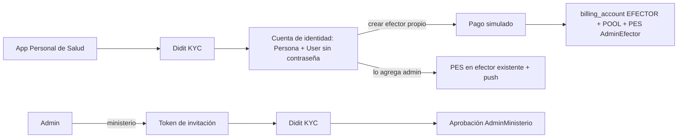

# Alta de cuenta y licencia

## De qué se trata

El alta es **identidad-primero** y se hace desde la app **Personal de Salud**: la persona verifica su identidad con **Didit** (documento + selfie, sin contraseñas) y obtiene una cuenta de identidad (Persona + User). El efector es una capa posterior: o lo crea la propia persona pagando (consultorio/clínica privada), o la agrega un `AdminEfector` de una organización (sin pago). El **ministerio** es asistido por admin (token + KYC), sin self-service. Login con huella/Face ID local; en un dispositivo nuevo se re-verifica con Didit.

## Actores

| Actor | Cómo entra |
|-------|------------|
| Cuenta de identidad | App Personal de Salud → Didit KYC → `POST /licencia/crear-cuenta` |
| AdminEfector (clínica / centro) | Identidad → `POST /licencia/registrar-efector` con `verification_id` + plan + pago |
| AdminEfector (consultorio unipersonal) | Igual, perfil `CONSULTORIO` **solo PRIVADO**, plan solo ambulatorio (1 profesional) |
| Profesional de una organización | El `AdminEfector` lo agrega (PES) → push → aparece en el wizard |
| AdminMinisterio | Solicitud asistida por admin → token de invitación → KYC → aprobación |
| Ops Bioenlace | Aprueba solicitudes y movimientos de pool |

## Cómo funciona

1. **Identidad:** `POST /licencia/crear-cuenta` con `verification_id` + `email` → Persona + User passwordless + JWT. No crea efector ni paga.
2. **Efector propio (privado):** `POST /licencia/registrar-efector` con `verification_id` (el backend resuelve la identidad) + plan + pago simulado → cuenta propia + entitlements.
3. **Público (solo clínica/centro):** elige ministerio (AFILIADO); si pide cobertura queda `PENDING` hasta que ops mueva el POOL.
4. **Consultorio:** perfil `CONSULTORIO` solo privado; plan ambulatorio con 1 profesional fijo; validación REFEPS/SISA en el alta.
5. **Profesional de una organización:** el `AdminEfector` lo agrega desde admin → push `profesional_agregado` a la app.
6. **Ministerio:** admin crea la solicitud y emite token; la persona completa KYC con `POST /licencia/completar-ministerio`; aprobación asigna rol `AdminMinisterio` + cuenta MINISTERIO.
7. **Desvincular pago ministerio / asociar:** AdminEfector autenticado vía API `desvincular-pago-ministerio` / `asociar-pago-ministerio`.

## Hardening del alta

- Workflow KYC Didit compartido (`didit_kyc_workflow_id`, fallback `didit_paciente_kyc_workflow_id`).
- Teléfono opcional validado E.164 (`ContactPhoneValidator`).
- Geo-gating AR/UY (`signupAllowedIso2`).
- Rate limit + honeypot en endpoints públicos (`SignupAbuseGuard`, `signupMaxPerIpHour`).

## Demo sandbox (probar sin crear cuenta)

Desde el sitio institucional, CTA **Probar demo** pide un captcha y un código de un solo uso (`POST /api/v1/licencia/demo-acceso`). El perfil elige médico (`demo_m_*`, AMB), médico odontología (`demo_m_*`, AMB, servicio ODONTOLOGIA), enfermería (`demo_e_*`, EMER) o administrativo (`demo_a_*`, EMER, ingreso a guardia). La especialidad del médico (subrol) se toma de la tabla `servicios`: el perfil `odontologia` no es un rol RBAC distinto, es un médico con `servicio = ODONTOLOGIA`. `/site/demo-entrar` solo consume el código y hace login (nunca la cuenta legacy `medico_med_general_*`). Se borran al cerrar sesión o al vencer el TTL.

Desde la app **Personal de Salud**, **Probar demo** lista los perfiles staff (`GET …/demo-perfiles`) y llama `POST /api/v1/licencia/demo-acceso-mobile` con el `role` elegido (médico AMB, médico odontología AMB, enfermería o administrativo EMER). Flag `demo_sandbox_habilitado` + knobs en `demo_sandbox` (params), incluido `require_captcha` (web) y `require_captcha_mobile` (app, off por defecto).

## Relación con el resto

- Modelo de pool: [matriz-argentina-modulos-precios.md](../modelo-de-negocio/business-plan/matriz-argentina-modulos-precios.md)
- Decisión: [onboarding-comercial-self-service.md](../decisions/onboarding-comercial-self-service.md)
- Admin: Licencias / Contratos + Solicitudes alta licencia
